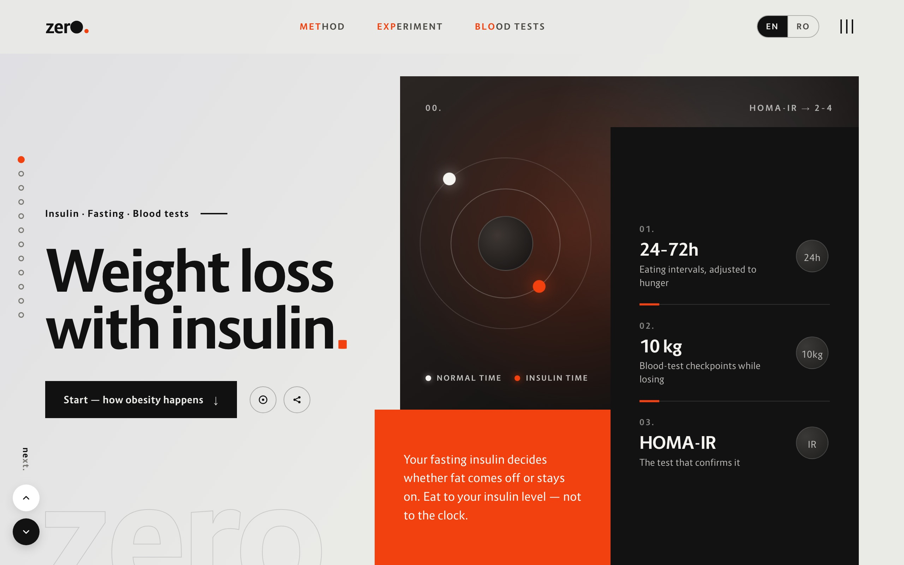

# Zero



**Weight loss with insulin.**

Zero is a bilingual (English / Romanian), dependency-free interactive web guide explaining how fasting blood insulin drives weight gain and how progressive fasting intervals (`24h`, `36h`, `48h`, `72h`) reverse insulin resistance and obesity.

## Overview

- **Core Thesis**: Obesity is driven by elevated fasting blood insulin rather than a simple caloric arithmetic error. Eating frequently keeps insulin elevated and locks energy in fat storage; extending eating intervals (`24h` → `36h` → `48h` → `72h`) lowers fasting insulin (`2–4 µIU/mL`) so the body mobilizes stored fat.
- **3 Food Categories by Insulin Response**:
  - **Type 1 (Low spike)**: Raw or cooked vegetables with salt, spices, brine, or vinegar (safe even during fasting windows).
  - **Type 2 (Moderate spike)**: Whole foods combining fiber, protein, and healthy fats for regular meals.
  - **Type 3 (High spike)**: Refined sugar, white flour, ultra-processed foods, and fruit juices—reserved for occasional rhythm rather than daily snacking.
- **Blood Test Biomarkers**: Tracks physiological recovery at every 10 kg of fat loss using **HOMA-IR** & **HOMA-B** (pancreas/insulin sensitivity), **ALT** & **AST** (liver), **ApoB** (cardiovascular), **eGFR** (kidney), and **hsCRP** (systemic inflammation).

## Technical Architecture

- **Zero Dependencies**: Pure HTML5, CSS3, and vanilla JavaScript—no frameworks or build step required.
- **Bilingual Live Switching (`EN` / `RO`)**: Instant client-side language toggle (`data-i18n` attributes) backed by full English (`source/english.md`) and Romanian (`source/romanian.md`) texts.
- **Adaptive Editorial UI**:
  - Automatic light (`#F1F0ED`) and dark (`#101010`) themes via `prefers-color-scheme`.
  - Section rail indicator, keyboard/button vertical section navigation (`prev` / `next`), and table-of-contents drawer.
  - Web App Manifest (`static/manifest.json`) for standalone mobile/desktop installation.

## Project Structure

- `index.html` — Single-page interactive reader with bilingual dictionary and section navigation.
- `static/` — Stylesheet (`style.css`), icons (`icon.png`, `icon.svg`), QR code, and `manifest.json`.
- `source/` — Source manuscripts in English (`english.md`) and Romanian (`romanian.md`) plus design references.
- `zero.conf` — Nginx server configuration.

## Running Locally

Serve the root directory with any static HTTP server:

```bash
python3 -m http.server 8000
```

Then open `http://localhost:8000`.
